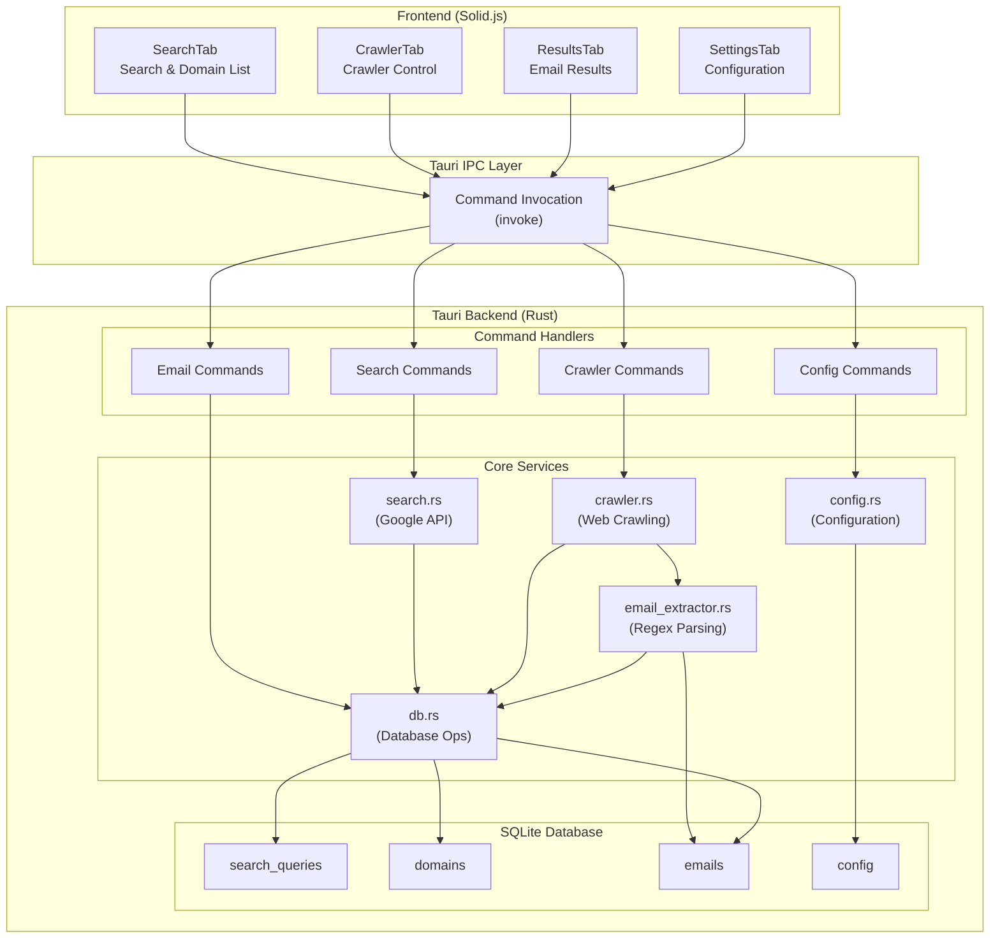
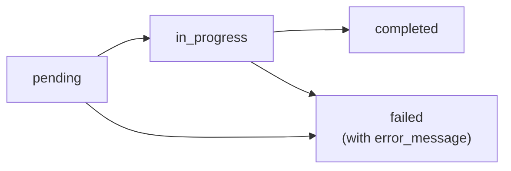
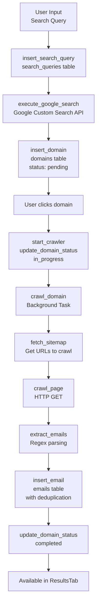
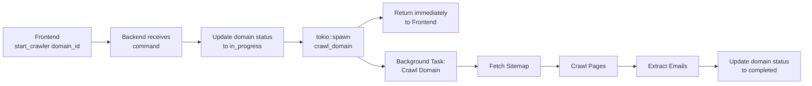
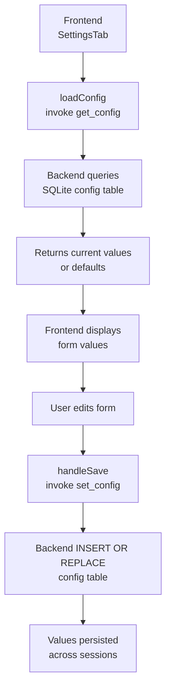
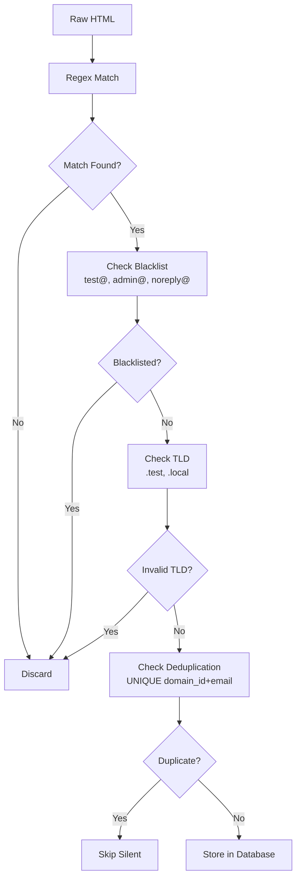
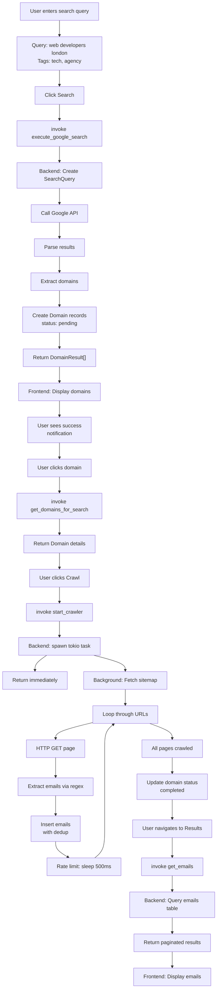

# Email Scraper Architecture Documentation

## Table of Contents

1. [Overview](#overview)
2. [Data Model](#data-model)
3. [Database Schema](#database-schema)
4. [Tauri Commands](#tauri-commands)
5. [Crawling System](#crawling-system)
6. [Configuration](#configuration)
7. [Email Extraction](#email-extraction)
8. [Frontend Structure](#frontend-structure)

---

## Overview

Email Scraper is a desktop application built with:

- **Frontend**: Solid.js with TypeScript, Vite bundler, Tailwind CSS + daisyUI
- **Desktop Framework**: Tauri 2.x (Rust + web frontend)
- **Backend**: Rust with Tokio async runtime
- **Database**: SQLite with type-safe queries via SQLx
- **External APIs**: Google Custom Search API

### Architecture Diagram



---

## Data Model

### Core Entities

#### 1. SearchQuery

Represents a user's search request for finding email sources.

```rust
pub struct SearchQuery {
    pub id: String,              // UUID v4
    pub query: String,           // Search terms (e.g., "web developers London")
    pub tags: String,            // JSON array of tags for organization
    pub created_at: String,      // RFC 3339 timestamp
    pub completed_at: Option<String>, // Timestamp when search finished
}
```

**Usage Flow**:

1. User enters search query + optional tags in SearchTab
2. Frontend invokes `execute_google_search` command
3. Backend creates SearchQuery record
4. Results are stored, linked to this SearchQuery ID

**Example**:

```json
{
  "id": "550e8400-e29b-41d4-a716-446655440000",
  "query": "web development agencies",
  "tags": "[\"technology\", \"london\", \"agencies\"]",
  "created_at": "2025-12-01T14:30:00Z",
  "completed_at": null
}
```

#### 2. Domain

Represents a website discovered from Google search results.

```rust
pub struct Domain {
    pub id: String,                    // UUID v4
    pub search_query_id: String,       // Foreign key to SearchQuery
    pub domain: String,                // Domain name (e.g., "example.com")
    pub url: String,                   // Full URL from search result
    pub title: Option<String>,         // Page title from search snippet
    pub description: Option<String>,   // Snippet/description from search
    pub crawl_status: String,          // pending, in_progress, completed, failed
    pub crawl_started_at: Option<String>,  // When crawling began
    pub crawl_completed_at: Option<String>, // When crawling finished
    pub error_message: Option<String>, // Error details if failed
    pub created_at: String,            // RFC 3339 timestamp
}
```

**Crawl Status Lifecycle**:



**Example**:

```json
{
  "id": "650e8400-e29b-41d4-a716-446655440001",
  "search_query_id": "550e8400-e29b-41d4-a716-446655440000",
  "domain": "example.com",
  "url": "https://example.com",
  "title": "Example Domain",
  "description": "Example of internet domain",
  "crawl_status": "pending",
  "crawl_started_at": null,
  "crawl_completed_at": null,
  "error_message": null,
  "created_at": "2025-12-01T14:30:05Z"
}
```

#### 3. Email

Extracted email address found on a domain.

```rust
pub struct Email {
    pub id: String,                // UUID v4
    pub search_query_id: String,   // Foreign key to SearchQuery (for filtering)
    pub domain_id: String,         // Foreign key to Domain
    pub domain: String,            // Domain name (denormalized for easy filtering)
    pub email: String,             // Email address (e.g., "contact@example.com")
    pub source_url: String,        // URL where email was found
    pub page_title: Option<String>, // Title of the page with email
    pub tags: String,              // JSON array of tags from original search
    pub found_at: String,          // RFC 3339 timestamp
}
```

**Deduplication**: Emails are checked before insertion:

- No duplicates on same domain_id + email combination
- Prevents spam and test email addresses

**Example**:

```json
{
  "id": "750e8400-e29b-41d4-a716-446655440002",
  "search_query_id": "550e8400-e29b-41d4-a716-446655440000",
  "domain_id": "650e8400-e29b-41d4-a716-446655440001",
  "domain": "example.com",
  "email": "contact@example.com",
  "source_url": "https://example.com/contact",
  "page_title": "Contact Us",
  "tags": "[\"technology\", \"london\", \"agencies\"]",
  "found_at": "2025-12-01T14:35:10Z"
}
```

#### 4. Config

Key-value configuration storage.

```rust
pub struct Config {
    pub key: String,     // Configuration key (e.g., "google_api_key")
    pub value: String,   // Configuration value
}
```

**Configuration Keys**:

| Key                       | Type   | Default | Description                            |
| ------------------------- | ------ | ------- | -------------------------------------- |
| `google_api_key`          | String | (empty) | Google Custom Search API key           |
| `google_search_engine_id` | String | (empty) | Google Custom Search Engine ID (cx)    |
| `max_pages_per_domain`    | u32    | 100     | Max pages to crawl per domain          |
| `max_crawl_depth`         | u32    | 3       | Max directory depth to crawl           |
| `request_timeout_secs`    | u32    | 10      | HTTP request timeout in seconds        |
| `rate_limit_delay_ms`     | u32    | 500     | Delay between requests in milliseconds |

### Related Structures

#### EmailListResponse

Paginated response for email queries.

```rust
pub struct EmailListResponse {
    pub emails: Vec<Email>,    // Emails for current page
    pub total: u32,            // Total number of emails
    pub page: u32,             // Current page number
    pub per_page: u32,         // Items per page
}
```

#### GoogleSearchResult

Result from Google Custom Search API.

```rust
pub struct GoogleSearchResult {
    pub title: String,   // Search result title
    pub link: String,    // Result URL
    pub snippet: String, // Search result snippet/description
}
```

#### Future-Reserved Structures

These types are designed for future features:

- **CrawlProgress**: Real-time progress tracking during crawling
- **EmailFilter**: Advanced email filtering (by tags, domain, search term)
- **SortBy**: Email sorting options (by email, domain, date)

---

## Database Schema

### Tables

#### search_queries

```sql
CREATE TABLE search_queries (
    id TEXT PRIMARY KEY,
    query TEXT NOT NULL,
    tags TEXT NOT NULL,              -- JSON array
    created_at TEXT NOT NULL,
    completed_at TEXT
)
```

**Indexes**:

- PRIMARY KEY on `id`
- Common queries: `created_at DESC` (for listing recent searches)

#### domains

```sql
CREATE TABLE domains (
    id TEXT PRIMARY KEY,
    search_query_id TEXT NOT NULL,
    domain TEXT NOT NULL,
    url TEXT NOT NULL,
    title TEXT,
    description TEXT,
    crawl_status TEXT NOT NULL,     -- pending, in_progress, completed, failed
    crawl_started_at TEXT,
    crawl_completed_at TEXT,
    error_message TEXT,
    created_at TEXT NOT NULL,
    FOREIGN KEY (search_query_id) REFERENCES search_queries(id)
)
```

**Indexes**:

- PRIMARY KEY on `id`
- Foreign key on `search_query_id` (for filtering by search)
- Composite on `search_query_id` + `crawl_status` (for pending domains)

#### emails

```sql
CREATE TABLE emails (
    id TEXT PRIMARY KEY,
    search_query_id TEXT NOT NULL,
    domain_id TEXT NOT NULL,
    domain TEXT NOT NULL,
    email TEXT NOT NULL,
    source_url TEXT NOT NULL,
    page_title TEXT,
    tags TEXT NOT NULL,              -- JSON array
    found_at TEXT NOT NULL,
    FOREIGN KEY (search_query_id) REFERENCES search_queries(id),
    FOREIGN KEY (domain_id) REFERENCES domains(id),
    UNIQUE(domain_id, email)         -- No duplicates per domain
)
```

**Indexes**:

- PRIMARY KEY on `id`
- Composite UNIQUE on `domain_id` + `email` (deduplication)
- Composite on `search_query_id` + `domain_id` (for filtering)
- Composite on `domain` (for domain-based queries)

#### config

```sql
CREATE TABLE config (
    key TEXT PRIMARY KEY,
    value TEXT NOT NULL
)
```

**Storage**: Uses `INSERT OR REPLACE` for upsert semantics

### Data Flow



---

## Tauri Commands

All commands are async and return `Result<T, String>` for error handling.

### Search Commands

#### execute_google_search

**Purpose**: Execute a Google Custom Search and store results in database.

**Parameters**:

```rust
pub struct SearchRequest {
    pub query: String,      // Search query
    pub tags: Vec<String>,  // Optional tags for organization
}
```

**Returns**: `Vec<DomainResult>` - Discovered domains

**Flow**:

1. Creates SearchQuery record
2. Validates API key and search engine ID configured
3. Calls Google Custom Search API
4. Parses URLs and creates Domain records
5. Returns discovered domains to frontend

**Error Cases**:

- "Google API key not configured" - API key missing
- "Google Search Engine ID not configured" - cx parameter missing
- "Request failed: {error}" - Network error
- "API returned status: {status}" - HTTP error from Google

**Frontend Call**:

```typescript
const result = await invoke<DomainResult[]>("execute_google_search", {
  request: { query: "web developers", tags: ["london", "tech"] }
});
```

#### get_searches

**Purpose**: Fetch all search queries from database.

**Parameters**: None

**Returns**: `Vec<SearchQuery>` - All searches ordered by created_at DESC

**Frontend Call**:

```typescript
const searches = await invoke<SearchQuery[]>("get_searches");
```

#### get_domains_for_search

**Purpose**: Get all domains discovered from a specific search.

**Parameters**:

```rust
searchId: String  // ID of the search query
```

**Returns**: `Vec<DomainResult>` - Domains for this search

**Frontend Call**:

```typescript
const domains = await invoke<DomainResult[]>("get_domains_for_search", {
  searchId: searchId
});
```

### Email Commands

#### get_emails

**Purpose**: Get paginated list of all emails.

**Parameters**:

```rust
page: u32       // Page number (1-indexed)
per_page: u32   // Items per page
```

**Returns**: `EmailListResponse`

**Frontend Call**:

```typescript
const response = await invoke<EmailListResponse>("get_emails", {
  page: 1,
  per_page: 50
});
```

#### get_emails_by_domain

**Purpose**: Get emails from a specific domain.

**Parameters**:

```rust
domain: String  // Domain name
page: u32       // Page number
per_page: u32   // Items per page
```

**Returns**: `EmailListResponse`

#### get_emails_by_query

**Purpose**: Get emails from a specific search query.

**Parameters**:

```rust
search_query_id: String
page: u32
per_page: u32
```

**Returns**: `EmailListResponse`

#### get_domain_stats

**Purpose**: Get email count by domain.

**Parameters**: None

**Returns**: `Vec<(String, u32)>` - Array of [domain, email_count]

### Crawler Commands

#### start_crawler

**Purpose**: Start crawling a domain in the background.

**Parameters**:

```rust
domain_id: String  // ID of domain to crawl
```

**Returns**: `"Crawler started"` - String confirmation

**Behavior**:

- Spawns background task
- Returns immediately to frontend
- Frontend should poll for status updates

**Frontend Call**:

```typescript
await invoke("start_crawler", { domainId: domainId });
```

#### get_pending_domains

**Purpose**: Get all domains with crawl_status = "pending".

**Parameters**: None

**Returns**: `Vec<Domain>` - Domains ready to crawl

**Use Case**: For implementing auto-crawling feature in future

### Configuration Commands

#### get_config

**Purpose**: Fetch all configuration from database with defaults.

**Parameters**: None

**Returns**: JSON object with all configuration keys and values

**Example Return**:

```json
{
  "google_api_key": "AIzaSy...",
  "google_search_engine_id": "c123...",
  "max_pages_per_domain": 100,
  "max_crawl_depth": 3,
  "request_timeout_secs": 10,
  "rate_limit_delay_ms": 500
}
```

**Frontend Call**:

```typescript
const config = await invoke<ConfigState>("get_config");
```

#### set_config

**Purpose**: Update configuration values in database.

**Parameters**:

```rust
pub struct ConfigUpdateRequest {
    pub google_api_key: Option<String>,
    pub google_search_engine_id: Option<String>,
    pub max_pages_per_domain: Option<u32>,
    pub max_crawl_depth: Option<u32>,
    pub request_timeout_secs: Option<u32>,
    pub rate_limit_delay_ms: Option<u32>,
}
```

**Returns**: `"Config updated successfully"`

**Frontend Call**:

```typescript
await invoke("set_config", {
  config: {
    google_api_key: "new-key",
    max_pages_per_domain: 150
  }
});
```

### Command Error Handling

All commands return `Result<T, String>` where errors are String messages:

```typescript
try {
  const result = await invoke<T>("command_name", { /* params */ });
} catch (error: any) {
  const errorMessage = error?.message || String(error);
  // Handle error
}
```

---

## Crawling System

### Architecture

The crawling system is event-driven and background-based:



### Crawl Process

#### Phase 1: URL Collection (Priority Order)

The crawler collects URLs to crawl in a specific priority order:

1. **Google Search Result URL (Highest Priority)**
   - The URL from the Google search result is **always crawled first**
   - Stored in `domain.url` field
   - Most likely to contain relevant content and contact information

2. **Sitemap URLs (Secondary)**
   - Fetches `https://domain.com/sitemap.xml`
   - Parses XML for `<loc>` elements
   - Includes all URLs from sitemap (up to `max_pages` limit)
   - Skips duplicates of the search result URL

3. **Domain Root (Fallback)**
   - If only the search result URL is available (no sitemap)
   - Adds `https://domain.com` as a secondary option
   - Ensures at least 2 pages are crawled when possible

**URL Deduplication**: The search result URL is never crawled twice, even if it appears in the sitemap.

#### Phase 2: Page Crawling

```rust
for url in urls_to_crawl {
    match crawl_page(&url).await {
        Ok(html) => {
            // Extract emails
            // Store results
        },
        Err(e) => {
            // Log error, continue
        }
    }
}
```

**For each URL**:

1. HTTP GET request with timeout
2. Extract HTML content
3. Extract page title from `<title>` tag
4. Extract emails using regex
5. Store non-duplicate emails

**Rate Limiting**:

- Configurable delay between requests
- Default: 500ms between pages
- Prevents server overload

#### Phase 3: Email Extraction

```rust
let emails = email_extractor::extract_emails(&html);
```

**Regex Pattern**:

```regex
[a-zA-Z0-9._%+-]+@[a-zA-Z0-9.-]+\.[a-zA-Z]{2,}
```

**Validation**:

1. Regex match for email format
2. Exclude test/demo addresses (test@, admin@, etc.)
3. Check valid TLD (not .test, .local)
4. Check domain has valid MX records (optional)

**Deduplication**:

```sql
UNIQUE(domain_id, email)
```

- Only one instance per domain
- Silently skips duplicates

#### Phase 4: Error Handling

```rust
db::update_domain_status(pool, domain_id, "failed", Some(error_msg)).await;
```

**Error Cases**:

- Network timeout → Error logged, status → "failed"
- Invalid HTML → Skip page, continue crawling
- Email extraction errors → Logged, continue

### Configuration Parameters

| Parameter               | Default | Impact                                 |
| ----------------------- | ------- | -------------------------------------- |
| `google_search_results` | 100     | Number of domains to fetch per search  |
| `max_pages_per_domain`  | 100     | Total pages crawled per domain         |
| `max_crawl_depth`       | 3       | Max directory depth (unused currently) |
| `request_timeout_secs`  | 10      | HTTP request timeout                   |
| `rate_limit_delay_ms`   | 500     | Delay between requests                 |

### Performance

**Typical Crawl**:

- Domain with 100 pages
- 500ms delay between requests
- 10s timeout per page
- **Worst case**: 100 × (10s + 0.5s) = ~1050 seconds ≈ 18 minutes

**Optimization Ideas**:

1. Parallel crawling (currently sequential)
2. Request pooling
3. Selective page crawling (avoid /archive/, /old/, etc.)
4. Smarter URL filtering

### Future Enhancements

- **CrawlProgress Events**: Real-time updates to frontend
- **Pause/Resume**: Stop and resume mid-crawl
- **Selective Crawling**: Skip certain URL patterns
- **JavaScript Rendering**: Handle dynamic content (with Puppeteer/Playwright)
- **Custom Headers**: Identify crawler with User-Agent

---

## Configuration

### How Configuration Works



### Configuration Storage

**Location**: `~/.config/email-scraper/app.db` (Tauri app data directory)

**Table**: `config` table with key-value pairs

```sql
-- Get configuration
SELECT value FROM config WHERE key = 'google_api_key';

-- Set/Update configuration
INSERT OR REPLACE INTO config (key, value) VALUES ('google_api_key', 'AIzaSy...');
```

### Default Values

If a configuration key is not in the database, `get_config` returns hardcoded defaults:

```json
{
  "google_api_key": "",
  "google_search_engine_id": "",
  "max_pages_per_domain": 100,
  "max_crawl_depth": 3,
  "request_timeout_secs": 10,
  "rate_limit_delay_ms": 500
}
```

### Google API Configuration

**Required for Search**:

1. Google API Key
   - From: Google Cloud Console → APIs & Services → Credentials
   - Type: API Key (unrestricted)

2. Custom Search Engine ID (cx parameter)
   - From: Programmable Search Engine control panel
   - Link: <https://programmablesearchengine.google.com/controlpanel/all>

**API Limits**:

- 100 free queries/day
- $5 per 1000 queries for additional requests
- Rate limit: ~1 query/second

---

## Email Extraction

### Validation Pipeline



### Implementation

**File**: `src-tauri/src/email_extractor.rs`

```rust
pub fn extract_emails(html: &str) -> Vec<String> {
    // Lazy-static compiled regex
    static EMAIL_REGEX: Lazy<Regex> = Lazy::new(|| {
        Regex::new(r"[a-zA-Z0-9._%+-]+@[a-zA-Z0-9.-]+\.[a-zA-Z]{2,}")
            .unwrap()
    });
    
    let mut emails = Vec::new();
    for cap in EMAIL_REGEX.captures_iter(html) {
        let email = cap[0].to_lowercase();
        
        // Validation checks
        if is_valid_email(&email) {
            if !emails.contains(&email) {
                emails.push(email);
            }
        }
    }
    
    emails
}

fn is_valid_email(email: &str) -> bool {
    // Filter test/demo addresses
    if email.starts_with("test@") || email.starts_with("admin@") {
        return false;
    }
    
    // Check valid TLD
    let domain = email.split('@').nth(1).unwrap_or("");
    if domain.ends_with(".test") || domain.ends_with(".local") {
        return false;
    }
    
    true
}
```

### Performance

- Compiled regex (lazy-static): ~0.1ms per page
- Memory: Single regex instance shared across all crawls
- Deduplication: O(1) via UNIQUE constraint

---

## Frontend Structure

### Component Organization

```dir
src/
├── App.tsx                     # Main app shell, tab routing
├── App.css                     # Global styles (@import "tailwindcss")
├── tabs/
│   ├── SearchTab.tsx           # Search UI + domain listing
│   ├── CrawlerTab.tsx          # Crawler status + controls
│   ├── ResultsTab.tsx          # Email results + filtering
│   └── SettingsTab.tsx         # Configuration UI
└── (future features)
```

### Tab: SearchTab

**Features**:

- Search form (query + tags)
- Recent searches list (daisyUI menu)
- Selected search results (domain list)
- Status notifications (info/success/error alerts)

**State**:

- `query`: Current search input
- `tags`: Tag input (comma-separated)
- `searches`: List of all searches
- `selectedSearchId`: Currently viewing
- `domainResults`: Domains for selected search
- `status`: Notification state (idle/loading/success/error)

**Commands Used**:

- `execute_google_search` → Perform search
- `get_searches` → Load recent searches
- `get_domains_for_search` → Load domains for search

### Tab: CrawlerTab

**Features**:

- List of domains ready to crawl
- Start crawler button per domain
- Crawl status display (pending/in_progress/completed/failed)
- Auto-refresh capabilities

**Commands Used**:

- `get_pending_domains` → Load domains to crawl
- `start_crawler` → Begin crawling

### Tab: ResultsTab

**Features**:

- Paginated email list
- Filter by domain
- Sort options (email, domain, date)
- Domain statistics
- Email export (future)

**Commands Used**:

- `get_emails` → All emails
- `get_emails_by_domain` → Emails from domain
- `get_emails_by_query` → Emails from search
- `get_domain_stats` → Email count by domain

### Tab: SettingsTab

**Features**:

- Google API key input (password field)
- Search engine ID input
- Crawler configuration sliders
- Save/Load functionality

**Commands Used**:

- `get_config` → Load current settings
- `set_config` → Save settings

### Styling

- **Framework**: daisyUI 5.5.5 (component library)
- **Utility CSS**: Tailwind CSS 4.x
- **Typography**: System fonts, responsive sizing
- **Colors**: Themeable via daisyUI themes (light/dark)

---

## Common Operations

### End-to-End: User Performs Search



### Checking Crawl Progress

Currently:

- Frontend must manually poll domain status
- `get_domains_for_search` shows current crawl_status

Future:

- Real-time CrawlProgress events via Tauri emitter
- WebSocket-style updates

---

## Error Handling

### Frontend → Backend Errors

```typescript
try {
  const result = await invoke<T>("command", params);
} catch (error: any) {
  const errorMsg = error?.message || String(error);
  // Display in notification alert
  setStatus("error");
  setStatusMessage(errorMsg);
  setTimeout(() => setStatus("idle"), 6000);
}
```

### Common Error Messages

| Error                                    | Cause                              | Resolution                       |
| ---------------------------------------- | ---------------------------------- | -------------------------------- |
| "Google API key not configured"          | Missing API key in Settings        | Enter key in Settings tab        |
| "Google Search Engine ID not configured" | Missing cx parameter               | Enter cx in Settings tab         |
| "Request failed: {error}"                | Network/timeout                    | Check internet, increase timeout |
| "API returned status: 403"               | API key invalid or quota exceeded  | Verify key, check quotas         |
| "Failed to parse response: {error}"      | Google API response format changed | Report as bug                    |

### Database Errors

Converted to strings and returned as Rust Result<T, String>:

```rust
db::insert_email(pool, &email)
    .await
    .map_err(|e| e.to_string())?  // Convert sqlx::Error to String
```

---

## Performance Considerations

### Database

- **SQLite**: Single-file database suitable for desktop app
- **Connection Pool**: Max 5 concurrent connections
- **Indexes**: On frequently queried columns
- **Deduplication**: UNIQUE constraint prevents duplicates

### Frontend

- **Solid.js**: Lightweight reactivity, fine-grained updates
- **Virtual Lists**: Not yet implemented (future optimization)
- **Pagination**: 50 emails per page by default
- **Search Lists**: Max 100 results displayed with scrolling

### Crawler

- **Sequential**: Crawls one page at a time
- **Rate Limiting**: 500ms between requests (configurable)
- **Background**: Non-blocking via tokio::spawn
- **Memory**: Loads one page HTML at a time

### Optimization Opportunities

1. **Parallel crawling**: Tokio tasks for multiple URLs
2. **Request pooling**: Reuse HTTP client connections
3. **Caching**: Browser cache control headers
4. **Database**: Connection pooling (already implemented)
5. **Frontend pagination**: Infinite scroll or virtual list

---

## Testing

### Manual Testing Checklist

- [ ] Search execution with valid API key
- [ ] Search with tags preserved in results
- [ ] Clicking domain loads its emails
- [ ] Crawler starts and updates domain status
- [ ] Settings save/load persists
- [ ] Email deduplication works
- [ ] Error messages display properly
- [ ] Pagination works correctly

### Integration Points to Test

1. **Google API Integration**
   - Valid API key → Results returned
   - Invalid key → Error shown
   - Quota exceeded → Handled gracefully

2. **Database Persistence**
   - Config persists across app restart
   - Emails deduplicated correctly
   - Search history preserved

3. **Crawling**
   - Sitemap parsing works
   - Fallback to root URL if no sitemap
   - Email extraction finds emails
   - Rate limiting prevents server overload

---

## Deployment

### Building for Release

```bash
# Build Tauri app (includes Rust backend + frontend)
bun run tauri build

# Output:
# - macOS: /target/release/bundle/macos/Email Scraper.app
# - Windows: /target/release/bundle/msi/EmailScraper_*.msi
# - Linux: /target/release/bundle/deb/email-scraper_*.deb
```

### Distribution

- **macOS**: DMG or app bundle
- **Windows**: NSIS installer (.msi)
- **Linux**: AppImage or .deb package

### Configuration for Deployment

- `.env` file should NOT be committed
- API keys must be entered by user in Settings
- Database location: User's app data directory (Tauri managed)

---

## Troubleshooting

### Search Returns No Results

1. Check Google API key is valid (Settings tab)
2. Check Custom Search Engine ID is correct
3. Verify Google Cloud Console shows API enabled
4. Check quota not exceeded (100 free queries/day)

### Crawler Not Starting

1. Check domain is in "pending" status
2. Check browser console for errors
3. Verify file permissions on app data directory

### Emails Not Found

1. Check page is HTML (not PDF/image)
2. Check email format is standard (<user@domain.com>)
3. Check crawler completed successfully
4. Check for JavaScript-rendered emails (need Puppeteer)

### Database Locked

1. Close all instances of app
2. Delete `app.db` to start fresh (loses data)
3. Check file permissions on app data directory

---

## Future Roadmap

### Features

- [ ] Real-time crawl progress with CrawlProgress events
- [ ] Pause/resume crawler mid-crawl
- [ ] Email filtering and advanced search
- [ ] Bulk export (CSV, JSON)
- [ ] Duplicate email detection across domains
- [ ] JavaScript-rendered email extraction (Puppeteer)
- [ ] Auto-crawl new domains from search
- [ ] Email validation (MX record check)
- [ ] Proxy support for rate limiting
- [ ] Multi-account support

### Performance

- [ ] Parallel domain crawling
- [ ] Frontend virtual list for large email lists
- [ ] Database query optimization
- [ ] Incremental crawling (delta updates)

### UI/UX

- [ ] Dark/light theme toggle
- [ ] Email preview pane
- [ ] Search history with filters
- [ ] Drag-drop import/export
- [ ] Keyboard shortcuts

---

## References

- **Tauri Documentation**: <https://tauri.app/>
- **Solid.js Documentation**: <https://docs.solidjs.com/>
- **SQLx Documentation**: <https://github.com/launchbadge/sqlx>
- **Google Custom Search API**: <https://developers.google.com/custom-search>
- **daisyUI Components**: <https://daisyui.com/>
- **Tailwind CSS**: <https://tailwindcss.com/>
